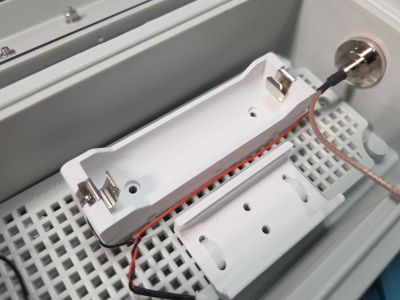
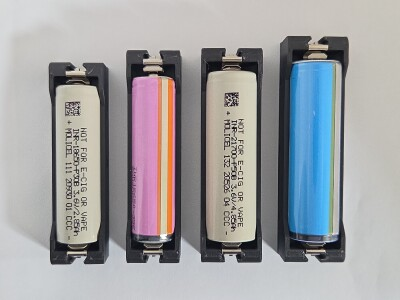
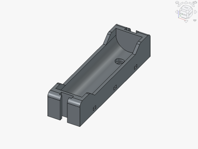
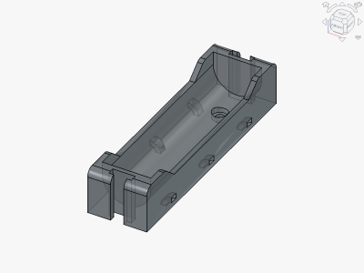

# Parametric Lithium-ion Battery Cell Holder

<table>
<tr>
<td></td>
<td></td>
</tr>
<tr>
<td></td>
<td></td>
</tr>
</table>

A 3D printable parametric lithium-ion battery cell holder, with variants for: 18650 / 21700, flat-top / button-top, protected / unprotected variants. Uses Keystone 209-style spring contacts for both positive and negative terminals. Provides two M3 mounting holes and six 3mm zip-tie slots, spaced for a 5mm grid. Made with FreeCAD.

Variant can be selected in the data pane of the "Parameters" spreadsheet. Cell dimensions and other parameters can be configured in the "Parameters" spreadsheet of the project file. Requires FreeCAD 26.3 or later.

**Design:** [li-ion-battery-holder.FCStd](li-ion-battery-holder.FCStd)

**STLs:**
- [li-ion-battery-holder-18650-flat.stl](stl/li-ion-battery-holder-18650-flat.stl)
- [li-ion-battery-holder-18650-button.stl](stl/li-ion-battery-holder-18650-button.stl)
- [li-ion-battery-holder-18650-protected.stl](stl/li-ion-battery-holder-18650-protected.stl)
- [li-ion-battery-holder-21700-flat.stl](stl/li-ion-battery-holder-21700-flat.stl)
- [li-ion-battery-holder-21700-button.stl](stl/li-ion-battery-holder-21700-button.stl)
- [li-ion-battery-holder-21700-protected.stl](stl/li-ion-battery-holder-21700-protected.stl)

**Recommended Print Settings:** 0.20mm layer height, 15-100% infill, no supports, PLA/PLA+/PETG/ASA

**License**: 
